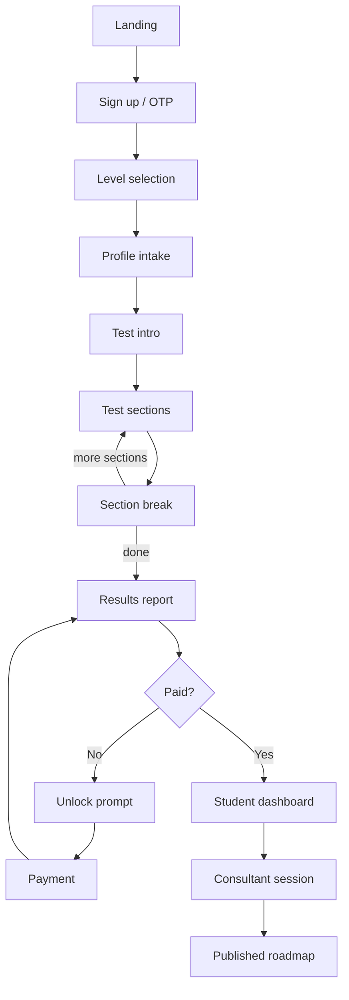

# CareerChecks: Product Structure & Module Documentation

> Source of truth for the AI coding agent. Derived from the CareerChecks screen wireframes (Batches 1-3: mobile, results/dashboards/ops, desktop variants).
> Items marked **[Assumed]** were inferred, not shown in the wireframes.
> **Section 9 (Decisions & Additions) overrides anything in sections 1-8.** Values marked **DEFAULT** in section 9 are sensible starting choices; change them in this file if the business decides otherwise.

---

## 1. Product Overview

CareerChecks is a career-guidance platform for Indian students. A student takes a ~35 minute psychometric and aptitude test, receives a report (interest code, aptitude, personality, career matches, college matches), and then works with a human consultant who reviews the results and publishes a personalised roadmap.

**Core promise:** "Find the course and college that fit you. Take the test, then meet a human consultant."

**Trust pillars (repeated across screens):** verified consultants with visible credentials, transparent pricing, "we never sell your data", autosave, pause anytime, no right or wrong answers.

**Business model:** Free tier (interest code + aptitude snapshot) and a paid tier (careers, colleges, consultant session). Free users see a blurred report from careers downward with an "Unlock" CTA.

**Platforms:** Mobile-first web with a desktop version of every key screen.

---

## 2. User Roles

| Role | Purpose | Main surfaces |
|---|---|---|
| Visitor | Evaluate the product, try one question | Landing page |
| Student (UG, after Class 12) | Take test, get report, follow roadmap | Onboarding, test, report, dashboard |
| Student (PG, graduating) | Same, plus a domain-knowledge section | Same, 5 sections (~45 min) |
| Parent | Reviews credibility and the student's report | Landing "For parents" strip, Share with parent link |
| Consultant | Reviews results, counsels, builds roadmaps | Consultant dashboard, Student 360 view |
| Admin | Operates funnel, assignments, content | Admin overview, question bank, colleges, consultants |

---

## 3. Overall Structure

### 3.1 End-to-end journey

1. **Landing**
2. **Sign up / OTP**
3. **Level selection (UG/PG)**
4. **Profile intake**
5. **Test intro**
6. **Test (question screens)**
7. **Timed aptitude MCQ**
8. **Section break** (repeated per section)
9. **Results report (free / paid)**
10. **Student dashboard**, then consultant session, then roadmap.

Behind this, the consultant uses **11. Consultant dashboard** and **12. Student 360 view**, and the admin uses **13. Admin overview**. **14. Empty/error states** apply everywhere.

### 3.2 Screen inventory

| # | Screen | Variants in wireframes |
|---|---|---|
| 1 | Landing | 1a classic scroll, 1b inline first question; desktop 3a, 3b |
| 2 | Sign up / OTP | 1c single screen, 1d separate screens (+WhatsApp, edit number); desktop 3c |
| 3 | Level selection | 1e stacked cards, 1f side-by-side desktop |
| 4 | Profile intake | 1g one topic per screen, 1h collapsible single scroll; desktop 3d |
| 5 | Test intro | 1i dotted-path list, 1j reassurance-first; desktop 3e |
| 6 | Test question screens (Likert, etc.) | Referenced; Likert shown on landing 1b |
| 7 | Timed aptitude MCQ | Desktop 3f (mobile referenced as 1m) |
| 8 | Section break | 2a celebration-first, 2b compact with teaser; desktop 3g |
| 9 | Results report | 2c long scroll (free vs paid), 2d desktop two-column |
| 10 | Student dashboard | 2e action-led mobile, 2f desktop |
| 11 | Consultant dashboard | 2g today-first |
| 12 | Consultant: Student 360 | 2h three panes |
| 13 | Admin overview | 2i funnel + queue + question bank |
| 14 | Empty / error states | 2j inline, 2k banners + full-page |

**Implementation rule:** pick ONE variant per screen. Defaults are in section 9.13.

### 3.3 Navigation map

- **Public:** Landing nav: How it works, Colleges, Consultants, Pricing, Log in, *Take the free test*.
- **Student app:** Home, Roadmap, Colleges, Chat, Profile (bottom tabs on mobile; top nav on desktop).
- **Consultant app:** Dashboard, Students (count), Sessions, Reviews (count), Chat.
- **Admin app:** Overview, Assignments (count), Question bank, Colleges, Consultants.

---

## 4. Module-wise Features

### Module 1: Landing & Marketing

**Goal:** convert visitors into test-takers or consultant enquiries and build parent trust.

- Hero with headline ("Find the course and college that fit *you*"), subtext and two CTAs: **Take the free test** and **Talk to a consultant**.
- Hero illustration (split hero on desktop).
- Trust bar: 5,000+ students, 80 consultants, 4.8 rating (placeholder numbers; make them editable config).
- "How it works" dotted-path stepper: Take test, Get matched, Meet consultant, Follow roadmap (vertical on mobile, horizontal on desktop).
- Audience split cards: **UG path (after Class 12)** and **PG path (graduating)**.
- Sample report preview.
- Social proof: student and parent testimonials carousel.
- Pricing teaser, FAQ accordion, footer.
- **Variant 1b (test in the hero):** first Likert question ("I enjoy figuring out how things work", 1-5, Disagree to Agree) shown inline with no sign-up; answering leads into the real test. Secondary link: "or talk to a consultant first".
- **Parent credibility strip:** Verified consultants (credentials visible), Transparent pricing, We never sell your data. Featured consultant card (e.g. "Meet Priya, 300+ students into design careers") and a "For parents" block.
- Desktop header: logo, section links, Log in, Take the free test.

### Module 2: Authentication (Phone + OTP)

- Phone number entry with country code (+91 default).
- Send OTP, then 6-digit code entry with per-box inputs.
- Resend timer (e.g. 0:24).
- Option to receive OTP via WhatsApp; "wrong number? Edit" link.
- Terms and privacy note; reassurance copy "We never sell your data".
- Two layouts: single screen with OTP sliding in, or separate screens.
- Desktop: split screen. Left reassurance panel ("Calm, private, yours. Autosave, pause anytime, never sold") with illustration; right form card.
- Log in for returning users (header button).
- Errors: invalid/expired OTP, resend limits **[Assumed]**.

### Module 3: Level Selection

- Step 1 of 5: "Where are you right now?"
- Two large cards: **Undergraduate** ("I've passed or am finishing Class 12") and **Postgraduate** ("I'm graduating or have graduated"), each with an illustration.
- Selected state: 2 px border plus checkmark.
- Desktop shows a per-level "what you'll get" list: UG has 4 test sections, ~35 min, colleges + exams; PG has 5 sections including domain check, ~45 min.
- Level determines test composition, report content, and consultant matching.

### Module 4: Profile Intake

Five steps: **Level, Marks, Aspiration, Budget, Review** (stepper on the left rail on desktop).

- **Marks & stream** (e.g. "92% PCM"). Fields not fully shown **[Assumed: board, stream, percentage]**.
- **Aspiration & location:** multi-select interest chips (Design, Tech, Media, Medicine, Law), preferred cities (tag input with search), "Open to relocating?" toggle.
- **Budget & knowledge:** budget bands (<₹2L, 2-5L, 5-10L, 10-20L, 20L+), fine-tune slider (e.g. ₹7,50,000), "Open to an education loan?" toggle, self-rated knowledge of options (1-5).
- **Review** step before submit.
- UX rules: one topic per screen with sticky Next, **autosave** ("Saved ✓"), Back/Next, progress bar.
- Alternative: single scroll with collapsible sections, "2 of 3 done", "Save & continue".
- Desktop adds a **"Why we ask"** panel explaining each question ("Helps us suggest colleges you can actually reach. Never sold.").
- Privacy reassurance on every step.

### Module 5: Test Engine

**5.1 Test intro**

- "Your test, in 4 parts, about 35 min, pause anytime."
- Section list with durations: **Interests** (10 min, untimed), **Aptitude** (12 min, timed), **Personality** (8 min), **Values** (5 min).
- Reassurance: autosaved, pause and resume anytime, answers are private; "There are no right or wrong answers here, just honest ones."
- Keyboard hints on desktop: keys 1-5 to answer, A-D for multiple choice, Enter for next.
- Start test CTA.

**5.2 Question types**

- **Likert (1-5):** Disagree to Agree, used for interests, personality and values.
- **Aptitude MCQ (A-D):** question stem (text and/or image), four options, one selected state, Next button.
- Calm timer in the header for timed sections (e.g. 4:12), progress bar and "Aptitude · Question 5 / 20".
- **Save & exit** at any time.
- Desktop layout: image stem left, options right.

**5.3 Section break**

- Celebration ("Section 2 done. 2 to go."), "Nice work. Saved ✓".
- Path progress and next-section card ("Up next: Personality, ~8 min · 40 questions · untimed").
- Compact variant adds a **teaser** ("A first glimpse: *You seem to enjoy solving problems with data*") with no scores.
- Continue, or **Pause and come back later**.

**5.4 Engine behaviours**

- Autosave per answer, resume from last question, offline answer caching ("Answers are saved on this phone").
- Timed-section handling (timer, expiry behaviour) **[Assumed]**; defined in 9.3.
- Scoring: RIASEC interest code, aptitude sub-scores (Logical, Verbal, Spatial), personality spectrums (five spectrums, deliberately without good/bad colouring).
- PG variant adds a domain-knowledge section.

### Module 6: Results Report

Long-scroll story order: **code, charts, careers, colleges**.

- **Interest code** (e.g. "IAR") with a one-sentence headline insight.
- **Radar chart** (RIASEC, top 3 highlighted) with a "view as table" toggle for accessibility.
- **Aptitude** bars: Logical, Verbal, Spatial.
- **Personality** spectrums (five, neutral colour).
- **Top careers** cards: cluster tag (Design, Eng, Media), career title (UX Designer, Data Scientist, Animator), fit % (92%, 88%, 81%), reasons ("Likes visual problems · Strong logic"), Explore link.
- **Colleges** grouped as **Safe / Target / Reach**, with a disclaimer: "guidance, not a verdict".
- **Free vs paid:** free shows code, radar and aptitude; content from careers downward is blurred with an "Unlock careers, colleges, consultant: See my results" card. Paid unlocks everything and the consultant CTA.
- Actions: **Share with parent** (free) / Share (paid), **Meet your consultant**.
- Desktop: two columns. Sticky left summary (code, headline, Meet your consultant, Share with parent, section anchors: Interests, Aptitude, Personality, Careers, Colleges) and a scrolling right column.
- Locked-section message: "Colleges are locked on the free plan. Unlock".

### Module 7: Student Dashboard & Roadmap

- Greeting ("Hi Aarav"), notifications bell, profile avatar.
- **Next step hero:** e.g. "Register for CUET by 22 Mar", deadline progress bar, days left (18), Start registration CTA.
- **Upcoming session card:** consultant, date/time in IST, **Join** (Join call on desktop).
- **Roadmap:** ordered milestones (Take test ✓, CUET registration due soon, Apply, Documents, Decide); **Primary | Backup** plan toggle.
- **Chat with consultant** entry with last message preview.
- **Saved colleges** (count) with "All →" link.
- Mobile: bottom tabs Home, Roadmap, Colleges, Chat, Profile. Desktop: roadmap as main column, side rail for session, chat and saved colleges.
- Empty states: "No sessions yet. Find a consultant".

### Module 8: Consultant Workspace

**8.1 Dashboard (today-first)**

- Stat tiles: Today (sessions), Students, Reviews due, Rating.
- Today's sessions list with times, student, level and Join.
- Pending roadmap reviews queue.
- Student table: Student, Level, Top cluster, Status (New / Booked / Live), Next action (Schedule / Review results / Publish roadmap).
- Sidebar: Dashboard, Students, Sessions, Reviews, Chat.

**8.2 Student 360 view (three panes)**

- *Left:* student summary (name, level, city, marks, budget), radar, aptitude bars; "Session in 2 h" badge.
- *Middle:* **engine recommendations** (e.g. UX Designer 92%, Data Scientist 88%) with rationale ("Why...") and actions **Accept / Edit / Override**.
- *Right:* **notes** (Private / Shared toggle, rich text) and **roadmap builder** (add milestone: exam / apply / prep, dates such as CUET · 22 Mar) with **Publish roadmap**.
- Human-in-the-loop: the consultant's decisions override the engine and feed the student's published roadmap.

### Module 9: Admin Console

- **Funnel strip:** Signups (1,240), Tests done (860), Paid (310), Sessions (270).
- **Assignment queue:** unassigned students (e.g. Sana · UG · Hindi · Lucknow) with a suggested consultant and match % (Priya M., 92%) and an **Assign** action.
- **Question bank:** counts and status by set (Aptitude 240 live, RIASEC 60, PG domain 180 draft).
- Sections: Overview, Assignments, Question bank, Colleges, Consultants.
- Consultant matching considers language, location, level and specialisation **[Assumed]**.

### Module 10: Payments & Monetisation

- Unlock CTAs on blurred report sections.
- Payment failure handling: "Payment didn't go through. You haven't been charged", Try again / Retry banner.
- Pricing page and plans are referenced but not wireframed **[Gap]**; defined in 9.2.

### Module 11: Cross-cutting: States & Quality

- **Empty states:** no sessions yet (Find a consultant), no colleges match (widening chips: Budget +₹2L, Add Nagpur), nothing here yet (one clear next action).
- **Errors:** payment failed (inline card or banner).
- **Offline:** banner "Offline: changes will sync" / "You're offline. Answers are saved on this phone."
- Patterns: inline states replace the content area while nav stays; transient issues use banners, full-page empties for the rest.
- Accessibility: table alternative for charts, keyboard shortcuts, no good/bad colour coding on personality.
- Privacy: consistent "never sold" messaging, private vs shared consultant notes.

---

## 5. Key Data Entities

| Entity | Key fields |
|---|---|
| User | id, phone, role, name, level (UG/PG), plan (free/paid) |
| StudentProfile | marks, stream, interests, preferred cities, relocate, budget, loan openness, knowledge level |
| TestSession | level, sections, status, current question, timestamps, autosave state |
| Question | section, type (Likert/MCQ), stem (text/image), options, correct key, status (live/draft) |
| Response | session, question, answer, time taken |
| Result | RIASEC code, radar scores, aptitude scores, personality spectrums |
| CareerMatch | cluster, title, fit %, reasons, consultant status (accepted/edited/overridden) |
| College | name, city, fees, exams, category (Safe/Target/Reach) |
| Consultant | profile, credentials, languages, rating, student count |
| Session (Booking) | student, consultant, datetime, status, join link |
| Roadmap | milestones (exam/apply/prep/documents/decide), dates, primary/backup, published flag |
| Note | author, visibility (private/shared), body |
| Payment | amount, status, plan unlocked |
| Message | thread, sender, body |

Additional entities required by section 9 are listed in 9.14.

---

## 6. Design System Observations

- **Colours:** indigo as primary (CTAs, selected states, progress), orange as an accent for upsell/unlock and teasers, pale indigo tint for highlighted cards, red for errors, grey for offline/neutral.
- **Components:** pill buttons, outlined cards, chips, toggles, circular numeric steppers on dotted paths, progress bars, OTP boxes, Likert circles, accordion, tabs, placeholders for illustrations/charts.
- **Tone:** calm, reassuring, non-judgemental, plain language.
- **Responsive rule:** each mobile screen has a desktop counterpart (split layouts, side rails, sticky summaries).

---

## 7. Technical Architecture

> Updated from the original [Assumed] section. This is now the decided stack.

- **Frontend + server:** Next.js (App Router) + TypeScript, Tailwind CSS, shadcn/ui. Landing pages are server-rendered for SEO.
- **Database:** SQLite via better-sqlite3 + Drizzle ORM with SQL migrations. WAL mode on. File stored on a persistent disk.
- **Validation:** Zod on every server input.
- **Charts:** a small chart library for radar and bars, each with a table alternative.
- **Integrations (behind interfaces):** OTP provider, Razorpay payments, email, video link provider, notifications.
- **Non-functional:** autosave and offline queue, role-based access enforced on the server, encrypted PII where needed, consent and data-privacy compliance.

---

## 8. Gaps & Open Questions (original list, now resolved in section 9)

1. Consultant match, booking and college explorer screens not wireframed: see 9.6 and 9.1.
2. Pricing plans, checkout and paid-tier contents: see 9.2.
3. Marks & stream and Review intake screens: see 9.15.
4. Personality/Values question formats and counts: see 9.3.
5. Timer behaviour on expiry or exit: see 9.3.
6. Share-with-parent mechanism: see 9.7.
7. Roadmap deadlines source: see 9.8.
8. Consultant availability, rescheduling, cancellation: see 9.6.
9. Notification channels and triggers: see 9.8.
10. Minor-user consent: see 9.7.
11. Localisation: see 9.1.

---

# 9. Decisions & Additions (overrides anything above)

> Values marked **DEFAULT** are chosen to let the agent proceed. The business owner should confirm or change them before launch.

## 9.1 Scope

- **MVP includes:** Modules 1-11 as written above, for **UG and PG** students.
- **Out of MVP (do not build):** native mobile apps, regional-language UI (English only for MVP; keep all UI text in a single translations file so it can be added later), standalone college explorer page, WhatsApp OTP and WhatsApp notifications, video calling built into the app (use pasted meeting links), parent login accounts, discount codes.
- **Colleges tab** in the student app shows only the student's report colleges and saved colleges (no free-search explorer).
- **Pick one variant per screen** (see 9.13).

## 9.2 Pricing and plans (DEFAULT)

- **Free plan:** interest code, radar, aptitude scores.
- **Paid plan name:** "Career Plan". **Price: ₹1,499**, one-time, inclusive of GST. All amounts stored in paise as integers. Price is a config value, not hardcoded in UI text.
- **Paid includes:** full report (personality, careers, colleges), **1 consultant session of 45 minutes**, a published roadmap, and chat with the assigned consultant for **30 days** after the session.
- **Refund rule:** full refund if no session is held within 14 days of payment because of a consultant or platform issue. Refunds are triggered manually by admin in MVP.
- **Currency:** INR only. Payment methods: whatever Razorpay checkout offers (UPI, cards, netbanking).
- **Pricing page:** shows the two plans in a comparison table with an FAQ on refunds.

## 9.3 Test rules (DEFAULT)

- **Question counts:**
  - Interests (RIASEC): 60 Likert items, 10 per letter. Untimed, target ~10 min.
  - Aptitude: 20 MCQ (A-D): 7 Logical, 7 Verbal, 6 Spatial. Timed 12 min.
  - Personality: 40 Likert items, 8 per spectrum across five spectrums. Untimed, target ~8 min.
  - Values: 20 Likert items. Untimed, target ~5 min.
  - PG domain knowledge: 30 MCQ, timed 10 min (PG only; total ~45 min).
- **Marketing copy:** the wireframe landing page says "15-minute test" but the test is ~35 minutes. Use **"about 35 minutes"** everywhere, and "pause anytime".
- **Timer rules:** the timer is tracked **server-side** (store section start time). On expiry the section is auto-submitted and the student moves to the section break screen. If the student leaves mid-section the timer keeps running; when they return after expiry, unanswered questions count as skipped and the section is submitted.
- **Untimed sections:** can be paused and resumed at any time, resuming at the last unanswered question.
- **Retakes:** one test per student in MVP. Admin can reset a student's test manually.
- **Skipping:** Likert items cannot be skipped. Aptitude items can be skipped (counted wrong).
- **Question order:** within a section, questions are shown in a fixed order per test session (randomised once at start and stored).

## 9.4 Scoring (DEFAULT, keep all numbers in `config/scoring.ts`)

- **Likert scale:** 1-5. Reverse-scored items are flagged in the question table and scored as 6 minus answer.
- **RIASEC:** each Interest item maps to exactly one letter. Letter score = sum of its items (range 10-50), shown 0-100 after normalising. **Interest code = top 3 letters by score.** Ties broken by the order R, I, A, S, E, C.
- **Aptitude:** Logical, Verbal, Spatial sub-scores = % correct within each sub-type (0-100). Overall aptitude = average of the three.
- **Personality:** five spectrums, each scored 0-100 and shown neutrally with both ends described:
  Reserved to Outgoing, Spontaneous to Organised, Practical to Imaginative, Competitive to Collaborative, Calm to Sensitive. Never label an end as good or bad.
- **Values:** top 3 values by score (e.g. Stability, Creativity, Income, Impact, Independence), used in career fit.
- **Career fit %:** `fit = 0.50 * interest_match + 0.30 * aptitude_match + 0.20 * personality_values_match`, each part 0-100.
  - `interest_match`: overlap of the student's RIASEC profile with the career's RIASEC tags (cosine similarity, scaled 0-100).
  - `aptitude_match`: how well the student's aptitude scores meet the career's required Logical/Verbal/Spatial levels.
  - `personality_values_match`: closeness to the career's typical spectrum ranges and top values.
  - Show the top 6 careers; store the reasons as 2-3 short plain-language strings generated from the highest-contributing factors (templates, not AI-generated).
- **College category** (uses `student_marks_percent`, college `cutoff_percent`, annual fees):
  - Exclude colleges whose total annual fees exceed the student's budget (unless the "open to a loan" toggle is on, then allow up to +30%).
  - **Safe:** marks >= cutoff + 5. **Target:** marks within cutoff ±5. **Reach:** marks below cutoff by more than 5 and up to 15. Colleges below that range are not shown.
  - Prefer colleges in the student's preferred cities; if "open to relocating" is on, include others.
  - Show at most 5 per category.
  - Always show the disclaimer: "guidance, not a verdict".

## 9.5 Content and data sources

- **Careers:** seed from `data/careers.csv` (~40 careers for MVP) with columns: `id, cluster, title, description, riasec_tags, logical_req, verbal_req, spatial_req, personality_profile, value_tags, levels (UG/PG)`. The agent creates a **sample file**; the business replaces it with real data.
- **Colleges:** seed from `data/colleges.csv` (~60 colleges) with: `id, name, city, state, type, annual_fees, cutoff_percent, exams, courses, level`. Sample file first; real data later.
- **Question bank:** seed from `data/questions.csv` with all sections' items (sample content first, to be replaced by psychometrically reviewed questions). Columns: `id, section, sub_type, type, stem_text, stem_image, options_json, correct_key, riasec_letter, spectrum, value_key, reverse_scored, level, status`.
- The seed script imports these CSVs. Admin can later edit questions, colleges and consultants in the admin console (create, edit, publish/unpublish; no bulk upload in MVP except CSV import for colleges).
- **All sample data must be clearly marked as sample** and must not be shown as real in production.

## 9.6 Booking and consultants (DEFAULT)

- **Session length:** 45 minutes. **Timezone:** IST shown everywhere; stored in UTC.
- **Video:** consultant pastes a meeting link (Google Meet or Zoom) per session; the student sees a **Join** button from 10 minutes before start.
- **Availability:** consultants set weekly recurring availability slots; admin can override. Students book from available slots.
- **Assignment:** after payment, the system suggests a consultant (language, city, level, specialisation, current load) and **admin confirms with Assign**. The student sees their assigned consultant and books a slot.
- **Rescheduling:** student may reschedule once, up to 24 hours before the session. Within 24 hours, rescheduling needs admin approval. No-shows by the student forfeit the session; consultant no-shows get a free rebook.
- **Chat:** simple text chat between student and assigned consultant, available from booking until 30 days after the session. No file attachments in MVP.

## 9.7 Parent sharing and consent (DEFAULT)

- **Share with parent:** generates an **expiring read-only link** (valid 7 days, revocable) to the student's report. No parent login. The link shows only what the student's plan unlocks.
- **Minors:** if the student's date of birth (collected at sign-up after OTP) makes them under 18, require a **parent/guardian consent checkbox** and a parent phone number. Store consent timestamp and version of the policy.
- **Data minimisation:** collect only the fields in this document. No Aadhaar or ID numbers. Never log phone numbers, OTPs or test answers.
- **Rights:** students can request **data export** (JSON) and **account deletion** from their profile; deletion removes personal data and anonymises results.
- **Never sold:** the "we never sell your data" statement must remain true. No third-party advertising or tracking scripts that receive student data.
- Privacy policy and terms pages are required before launch (placeholder legal text is acceptable in development; replace with reviewed text).

## 9.8 Roadmap and notifications (DEFAULT)

- **Roadmap deadlines:** entered manually by the consultant per student for MVP. No exam calendar integration. The "Next step" hero shows the nearest upcoming milestone.
- **Roadmap versions:** a roadmap has a draft state (consultant only) and a published state (student sees it). Re-publishing replaces the visible version. Students see Primary and Backup plans.
- **Notifications in MVP:** in-app bell plus email for: session booked, session reminders (24 hours and 1 hour before), roadmap published, payment success or failure, new chat message (email only if unread after 30 minutes).
- WhatsApp and SMS notifications are out of MVP (SMS/WhatsApp only for OTP in production).

## 9.9 Integrations (MVP)

- **OTP:** `OtpProvider` interface. Dev: mock provider prints the code to the server console. Production: SMS provider to be chosen (supports Indian DLT rules).
- **Payments:** Razorpay in **test mode** first. Create order server-side, verify the signature, handle the webhook idempotently, store `razorpay_order_id`, `razorpay_payment_id`, status.
- **Email:** `EmailProvider` interface; dev logs to the console.
- **Video:** none (pasted links).
- **Analytics:** privacy-respecting page analytics only; no student answers or personal data sent.

## 9.10 Non-functional

- **Hosting:** a single server in India (Mumbai region) with a persistent disk for the SQLite file. Not a serverless platform.
- **Backups:** nightly SQLite backup (using the backup API) copied to object storage, with a documented restore procedure. Test a restore before launch.
- **Scale target:** ~500 students at launch, ~50 concurrent test-takers. If sustained write contention appears, plan a move to PostgreSQL (keep SQL portable).
- **Performance:** pages usable on mid-range Android phones on 4G; landing page loads fast with optimised images.
- **Browsers:** latest Chrome, Safari, Edge, and mobile browsers on Android and iOS.
- **Accessibility:** WCAG AA contrast, keyboard navigation on desktop, table alternatives for all charts, focus states, labelled form fields.
- **Security:** rate limits on OTP, login, payments and chat; server-side role checks on every route; security headers; secrets only in environment variables.

## 9.11 Acceptance criteria (the agent must satisfy these)

1. A new student can sign up with OTP, complete profile intake, finish the test on mobile, see the free report, pay in test mode, and see the full report.
2. A student can close the browser mid-test and resume at the right question; timed sections respect the server-side timer.
3. A consultant can open an assigned student, accept/edit/override recommendations, add private and shared notes, and publish a roadmap that the student sees.
4. An admin can see the funnel, assign a consultant, and publish or unpublish questions.
5. A free user can **never** receive locked report data from the API (verified by automated test).
6. A consultant can **never** open a student who is not assigned to them (verified by automated test).
7. Correct answer keys are never sent to the client (verified by automated test).
8. A failed payment never unlocks the report; a repeated webhook never double-credits.
9. All screens have loading, empty, error and offline states.
10. Typecheck, lint and all tests pass; the README explains setup, seeding, running, backup and restore.

## 9.12 Glossary

- **UG:** undergraduate, a student after Class 12. **PG:** postgraduate, a student graduating or graduated.
- **RIASEC:** Realistic, Investigative, Artistic, Social, Enterprising, Conventional (interest types).
- **Safe / Target / Reach:** college categories by chance of admission.
- **CUET:** Common University Entrance Test (example exam in the wireframes).
- **Roadmap:** the dated list of milestones (exam, apply, prep, documents, decide) the consultant publishes for a student.

## 9.13 Variant decisions (one per screen)

| Screen | Use this variant |
|---|---|
| Landing | 1a classic scroll (desktop 3a). Add the 1b inline first question only after launch. |
| Sign up / OTP | 1d separate screens with edit number (desktop 3c) |
| Level selection | 1e stacked cards on mobile, 1f side-by-side on desktop |
| Profile intake | 1g one topic per screen (desktop 3d with "Why we ask" panel) |
| Test intro | 1j reassurance-first (desktop 3e) |
| Section break | 2a celebration-first (desktop 3g); teaser from 2b is optional later |
| Results report | 2c long scroll on mobile, 2d two-column on desktop |
| Student dashboard | 2e action-led on mobile, 2f on desktop |
| Consultant dashboard | 2g today-first |
| Student 360 | 2h three panes |
| Admin overview | 2i |
| Empty / error | 2j inline for content areas, 2k banners and full-page for global errors |

## 9.14 Additional entities (needed by the decisions above)

| Entity | Key fields |
|---|---|
| OtpCode | phone, code hash, expires at, attempts, consumed at |
| AuthSession | user, token hash, expires at, device info |
| ConsentRecord | user, parent phone, policy version, accepted at |
| ParentShareLink | result, token hash, expires at, revoked at |
| Availability | consultant, weekday, start time, end time |
| Notification | user, type, payload, read at, emailed at |
| AuditLog | actor, action, target student, timestamp (every consultant/admin access to a student's data) |
| TestSectionProgress | session, section, started at, deadline, submitted at |
| SavedCollege | student, college |
| Config | key, value (price, trust-bar numbers, scoring weights where editable) |

All IDs are text (UUID/ULID). Timestamps are stored in UTC. Enums are text with CHECK constraints. Booleans are 0/1. JSON is stored as text and validated with Zod.

## 9.15 Marks and review intake details (DEFAULT)

- **Marks step fields:** board (CBSE, ICSE, State, Other), stream (Science PCM, Science PCB, Commerce, Arts/Humanities, Other), percentage (0-100), and for PG students: degree, specialisation, graduation year, CGPA or percentage.
- **Aspiration step:** up to 3 interest chips from the list, up to 5 preferred cities, relocate toggle.
- **Budget step:** budget band, fine-tune slider (₹0.5L-₹30L), education-loan toggle, knowledge rating 1-5.
- **Review step:** shows a summary of all answers with an Edit link per step, then "Start my test". Date of birth and consent (9.7) are collected between OTP and level selection.
